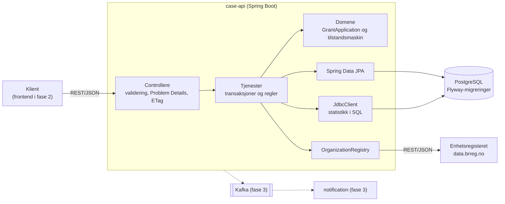

# Saksgang

Saksgang er et søknads- og saksbehandlingssystem for tilskudd. En innbygger søker om tilskudd på vegne av en organisasjon, og en saksbehandler behandler søknaden fra mottak til vedtak.

[](https://github.com/NikolaVetnic/saksgang/actions/workflows/case-api.yml)

## Hvorfor

Prosjektet viser hvordan et lite, men realistisk fagsystem for offentlig sektor kan bygges med stacken som er vanlig der: Spring Boot, Java og Kotlin, React og TypeScript, PostgreSQL, Kafka, Maven, Jenkins og OpenShift. Hovedvekten ligger på lesbar kode, tydelige arkitekturvalg og testautomasjon, ikke på mengden funksjonalitet.

Domenet er bevisst enkelt:

- En søknad gjelder en organisasjon med gyldig organisasjonsnummer. Navnet hentes fra Enhetsregisteret, slik at søkeren ikke kan skrive det feil.
- En saksbehandler flytter søknaden gjennom en fast saksgang og skriver notater underveis.
- Hver statusendring lagres med begrunnelse.

```
RECEIVED → IN_REVIEW → APPROVED
                     → REJECTED
```

## Status

| Fase | Innhold | Status |
|---|---|---|
| 1 | `case-api`: REST-API i Java og Spring Boot med PostgreSQL, integrasjon mot Enhetsregisteret og tester | Ferdig |
| 2 | `frontend`: React, TypeScript og Redux Toolkit | Planlagt |
| 3 | Kafka og `notification` (Kotlin), med outbox-mønster | Planlagt |
| 4 | Jenkins, Nexus og OpenShift | Planlagt |
| 5 | Observerbarhet med Prometheus, Grafana og Splunk | Planlagt |

## Arkitektur



Koden er delt inn etter feature (`grantapplication`, `organization`, `statistics`), med controller, service og repository inne i hver feature. Domenet vet ingenting om HTTP. Feil blir til statuskoder ett sted, i `ApiExceptionHandler`.

Viktige valg er dokumentert som ADR-er i [`docs/adr`](docs/adr):

| ADR | Beslutning |
|---|---|
| [0001](docs/adr/0001-monorepo-og-maven.md) | Monorepo og Maven |
| [0002](docs/adr/0002-flyway-og-eksplisitt-sql.md) | Flyway for skjemaet, JPA for CRUD og eksplisitt SQL for rapporter |
| [0003](docs/adr/0003-engelsk-i-kode-database-og-api.md) | Engelsk i kode, database og API |
| [0004](docs/adr/0004-feature-og-lag.md) | Inndeling etter feature med lag, ikke vertical slices |
| [0005](docs/adr/0005-problem-details-og-feilkoder.md) | Problem Details og feilkoder |
| [0006](docs/adr/0006-optimistisk-laasing-med-etag.md) | Optimistisk låsing med ETag og `If-Match` |

## API

| Metode | Sti | Beskrivelse |
|---|---|---|
| `POST` | `/api/grant-applications` | Send inn søknad. Organisasjonsnavnet hentes fra Enhetsregisteret. |
| `GET` | `/api/grant-applications?status=&page=&size=&sort=` | List søknader med filter og paginering |
| `GET` | `/api/grant-applications/{id}` | Hent én søknad med statushistorikk og notater. Svaret har `ETag`. |
| `POST` | `/api/grant-applications/{id}/status` | Endre status med begrunnelse. Krever `If-Match`. |
| `POST` | `/api/grant-applications/{id}/notes` | Legg til saksnotat |
| `GET` | `/api/statistics` | Antall søknader og sum av beløp per status |

Feil returneres som [RFC 9457 Problem Details](https://www.rfc-editor.org/rfc/rfc9457):

| Status | Når |
|---|---|
| 400 | Ugyldig forespørsel. Feltfeilene står i `errors`. |
| 404 | Søknaden finnes ikke |
| 409 | Ugyldig statusovergang. Gjeldende og tillatte statuser er med i svaret. |
| 412 | Søknaden er endret siden klienten hentet den |
| 422 | Organisasjonen er ukjent eller slettet i Enhetsregisteret |
| 428 | `If-Match` mangler ved statusendring |
| 503 | Enhetsregisteret svarer ikke |

Når appen kjører, finnes OpenAPI-dokumentasjonen på <http://localhost:8080/swagger-ui.html>.

## Kjøre lokalt

Du trenger JDK 25 og Docker. Maven trenger du ikke, fordi Maven Wrapper (`./mvnw`) følger med.

```bash
docker compose -f infra/docker-compose.yml up -d --wait
cd case-api
./mvnw spring-boot:run
```

Appen starter på <http://localhost:8080>, kobler seg til den lokale PostgreSQL-databasen og slår opp organisasjoner i det ekte Enhetsregisteret.

Et eksempel på en hel saksgang:

```bash
# Send inn en søknad
curl -i -X POST localhost:8080/api/grant-applications \
  -H 'Content-Type: application/json' \
  -d '{"organizationNumber":"974760673","applicantName":"Ola Nordmann",
       "applicantEmail":"ola.nordmann@example.com","amount":25000,
       "purpose":"Nye drakter til barnelaget"}'
# → 201 Created, ETag: "0"

# Ta søknaden til behandling, basert på versjonen du har sett
curl -i -X POST localhost:8080/api/grant-applications/<id>/status \
  -H 'Content-Type: application/json' -H 'If-Match: "0"' \
  -d '{"status":"IN_REVIEW","reason":"Tildelt saksbehandler"}'
# → 200 OK, ETag: "1"
```

## Tester

```bash
cd case-api
./mvnw test      # enhets- og komponenttester (Surefire)
./mvnw verify    # alt, også integrasjonstestene (Failsafe)
```

Testene trenger Docker, fordi PostgreSQL startes i Testcontainers. Ingen tester kaller det ekte Enhetsregisteret. Det simuleres med WireMock.

| Nivå | Eksempler | Verktøy |
|---|---|---|
| Enhet | Tilstandsmaskinen, mod11-validering, tjenester med mocks | JUnit 5, AssertJ, Mockito |
| Web | HTTP-kontrakt, validering, feilkoder | `@WebMvcTest`, `MockMvcTester` |
| Database | Repositories, SQL-spørringer, samtidige endringer | `@DataJpaTest`, `@SpringBootTest`, Testcontainers |
| Kontrakt | Klienten mot Enhetsregisteret | WireMock |
| Integrasjon | Hele API-flyten over ekte HTTP | `RestTestClient`, Testcontainers, WireMock |

GitHub Actions kjører `./mvnw verify` på hver push og pull request. Jenkins tar over i fase 4.

## Teknologi

- Java 25, Spring Boot 4, Maven
- Spring Web MVC, Spring Data JPA (Hibernate), `JdbcClient`, Bean Validation
- PostgreSQL 18, Flyway
- springdoc-openapi
- JUnit 5, AssertJ, Mockito, Testcontainers, WireMock

## Repostruktur

```
.
├── case-api/            # REST-API i Java og Spring Boot (fase 1)
├── infra/
│   └── docker-compose.yml
├── docs/
│   ├── adr/             # arkitekturbeslutninger
│   └── ki-bruk.md       # bruk av KI-verktøy i prosjektet
└── .github/workflows/   # CI
```

`frontend/`, `notification/` og infrastrukturen for Jenkins, OpenShift og observerbarhet kommer i senere faser.
